# Predicción de Precios de Viviendas (Ames Housing Dataset)

**Evaluación Parcial N°1 (con correcciones) + Evaluación Parcial N°2 — MLY1101 Machine Learning**  
**Caso B: Predicción de precios de viviendas (Housing Prices)**

**Autor(es):** Nicolas Carrasco, Martin Corvalan, Martin Naranjo  
**Fecha:** 10-09-2026 · **Última actualización:** 26-10-2026

---

## Resumen del proyecto

Se desarrolló un modelo de regresión para predecir el precio de venta de viviendas de Ames, Iowa (2.930 ventas, 2006-2010), siguiendo la metodología CRISP-DM. Se compararon tres modelos supervisados (Regresión Ridge/Lasso, Random Forest y Gradient Boosting) y se agregó un modelo no supervisado (K-Means) para segmentar el mercado.

| | Resultado |
|---|---|
| **Modelo final** | **Regresión Ridge** (`alpha` = 30), entrenada sobre `log1p(SalePrice)` |
| **Desempeño en prueba** (586 viviendas no vistas) | R² 0,959 · RMSE US$ 18.170 · MAE US$ 12.574 · MAPE 7,15% |
| **Criterio de salida** | Los tres modelos cumplen los cuatro umbrales (R² ≥ 0,80; RMSE ≤ US$ 30.000; MAE ≤ US$ 20.000; MAPE ≤ 12%) |
| **Hallazgo clave** | El modelo lineal regularizado compite de igual a igual con Gradient Boosting y es más estable y explicable |
| **Riesgo principal** | Desempeño no uniforme entre barrios (p. ej. `ClearCr`, MAPE 12,5%) y representatividad desigual de los datos por barrio |

### Qué se corrigió respecto de la Evaluación 1

| Ítem de la rúbrica EV1 | Corrección aplicada | Dónde está |
|---|---|---|
| Entregables | Estructura de carpetas ordenada; `.gitignore` corregido para versionar datos limpios, modelos e imágenes | [Estructura del proyecto](#16-estructura-del-proyecto-y-cómo-ejecutarlo) |
| Especificación del dataset | Tabla detallada de las 79 variables predictoras con tipo de dato, tipo de variable y descripción | [7.1](#71-especificación-detallada-de-las-variables) |
| Calidad y limpieza de datos | Detección sistemática de outliers (IQR) en las 37 variables numéricas, con interpretación por tipo de variable | [8.5](#85-detección-sistemática-de-outliers) |
| EDA | Correlaciones de Spearman y Kendall además de Pearson; análisis de multicolinealidad entre predictoras | [8.3](#83-correlaciones-lineales-y-no-lineales-con-saleprice) y [8.4](#84-multicolinealidad-entre-variables-predictoras) |
| Preparación inicial de datos | Clasificación explícita de cada variable por tipo, justificación de la transformación según el tipo, evaluación de PCA y número de variables finales por modelo | [9.4 a 9.7](#94-clasificación-de-las-variables-por-tipo) y [11](#11-variables-finales-e-implementación-de-los-modelos) |
| Sesgos | Se corrigió el argumento de sesgo de selección y se agregó evidencia empírica de la representatividad por barrio | [13](#13-análisis-de-sesgos-ética-y-privacidad) |

---

## Índice

1. [Contexto y problema de negocio](#1-descripción-del-contexto--problema-de-negocio)
2. [Objetivos](#2-objetivos-del-proyecto)
3. [Criterio de salida general](#3-definición-inicial-de-criterio-de-salida-para-los-algoritmos-de-machine-learning)
4. [Selección inicial de algoritmos](#4-selección-inicial-de-algoritmos-máximo-3)
5. [Métricas](#5-determinación-y-justificación-de-las-métricas-seleccionadas)
6. [Umbrales de aceptación](#6-criterio-de-salida-umbral-de-métricas-para-considerar-el-modelo-válido)
7. [Fuentes de datos y especificación de variables](#7-descripción-de-las-fuentes-de-datos-utilizadas)
8. [Análisis exploratorio (EDA)](#8-análisis-exploratorio-de-los-datos-eda)
9. [Preparación y transformación de los datos](#9-preparación-y-transformación-de-los-datos)
10. [Justificación de la selección de modelos](#10-justificación-de-la-selección-de-modelos)
11. [Variables finales e implementación de los modelos](#11-variables-finales-e-implementación-de-los-modelos)
12. [Evaluación y selección del modelo](#12-evaluación-y-selección-del-modelo)
13. [Sesgos, ética y privacidad](#13-análisis-de-sesgos-ética-y-privacidad)
14. [Interpretación y recomendaciones de negocio](#14-interpretación-y-recomendaciones-de-negocio)
15. [Limitaciones y mejoras](#15-limitaciones-y-posibles-mejoras)
16. [Estructura del proyecto y cómo ejecutarlo](#16-estructura-del-proyecto-y-cómo-ejecutarlo)

---

## 1. Descripción del contexto / problema de negocio

Una inmobiliaria / portal de tasación necesita **estimar de forma automática y objetiva el precio de venta de una vivienda** a partir de sus características físicas, de ubicación y de calidad constructiva. Actualmente la tasación depende en gran medida del criterio de un agente o tasador, lo que genera:

- **Inconsistencia** entre tasaciones de propiedades similares
- **Tiempos de respuesta lentos** para dar un precio de referencia a un cliente
- **Dificultad para justificar** de manera cuantitativa el precio sugerido

El dataset utilizado es **Ames Housing Dataset** (Ames, Iowa, EE.UU.), que contiene **2.930 registros de ventas residenciales** ocurridas entre 2006 y 2010, con **82 variables** que describen aspectos como superficie, calidad de materiales, año de construcción, garage, sótano, barrio (`Neighborhood`), condiciones de venta, entre otras.

---

## 2. Objetivos del proyecto

**Objetivo general:**
> Desarrollar un modelo de Machine Learning de regresión capaz de predecir el precio de venta (`SalePrice`) de una vivienda en Ames, Iowa, a partir de sus características estructurales, de calidad y de ubicación.

**Objetivos específicos:**
1. Comprender la estructura, calidad y distribución de los datos disponibles (EDA)
2. Identificar las variables con mayor poder explicativo sobre el precio de venta
3. Preparar y transformar los datos (limpieza, imputación, codificación, escalado) dejándolos listos para el modelamiento
4. Evaluar posibles sesgos, aspectos éticos y de privacidad asociados al uso de estos datos
5. Entrenar, comparar y seleccionar un modelo según métricas y umbrales definidos de antemano
6. Dejar una base reproducible (notebook + datos + informe) que permita repetir todo el análisis

---

## 3. Definición inicial de criterio de salida para los algoritmos de Machine Learning

- **Tipo de problema:** `SalePrice` es una variable **numérica continua**, por lo tanto este es un problema de **aprendizaje supervisado de regresión**.
- **Criterio de salida general:** el modelo se considerará una solución viable si predice el precio de venta con un error lo suficientemente bajo y consistente como para servir de referencia confiable a un tasador, y si dicho error **no varía de forma desproporcionada entre distintos segmentos** (por ejemplo, entre barrios o entre viviendas baratas y caras).
- **En términos operativos:** un buen ajuste global (R²) combinado con un error absoluto y porcentual acotado (MAE, RMSE, MAPE), siempre evaluados sobre datos de prueba no usados en el entrenamiento.

---

## 4. Selección inicial de algoritmos (máximo 3)

| N° | Algoritmo | Justificación de la selección |
|---|---|---|
| 1 | **Regresión Lineal Múltiple** (con regularización Ridge/Lasso) | Modelo **base (baseline)** simple e interpretable. Permite cuantificar el efecto de cada variable sobre el precio y sirve como punto de comparación mínimo exigible. Funciona especialmente bien tras la transformación logarítmica de `SalePrice`. |
| 2 | **Random Forest Regressor** | Ensamble de árboles capaz de capturar **relaciones no lineales e interacciones** sin especificarlas manualmente. Es robusto frente a variables poco relevantes y entrega **importancia de variables**. |
| 3 | **Gradient Boosting Regressor** | Suele ofrecer el **mejor desempeño predictivo** en datos tabulares de tamaño medio, al construir árboles de forma secuencial que corrigen los errores de los anteriores. Se incluye como candidato de "techo de desempeño". |

La comparación evalúa el **trade-off entre interpretabilidad y desempeño predictivo**. En la Evaluación 2 se agregó, como complemento, un modelo no supervisado (**K-Means**) para segmentar el mercado.

---

## 5. Determinación y justificación de las métricas seleccionadas

| Métrica | Descripción | Por qué se selecciona |
|---|---|---|
| **RMSE** | Raíz del promedio de los errores al cuadrado | Está en dólares, es fácil de interpretar y **penaliza más los errores grandes**, relevantes en tasación |
| **MAE** | Promedio del valor absoluto de los errores | Es menos sensible a outliers; representa el "error típico" esperado en dólares |
| **R²** | Proporción de la varianza de `SalePrice` explicada por el modelo | Ajuste global estandarizado (0 a 1), útil para comparar modelos |
| **MAPE** | Error absoluto promedio como porcentaje del valor real | Es la métrica más intuitiva para el negocio inmobiliario, que habla en términos porcentuales |

Se descartan métricas de clasificación (accuracy, F1, AUC) por no aplicar a regresión. Todas las métricas se calculan **en dólares**, devolviendo las predicciones del logaritmo a su escala original con `expm1`.

---

## 6. Criterio de Salida: umbral de métricas para considerar el modelo válido

| Métrica | Umbral de aceptación | Interpretación de negocio |
|---|---|---|
| **R²** | ≥ 0,80 | El modelo explica al menos el 80% de la variabilidad del precio |
| **RMSE** | ≤ US$ 30.000 | Aprox. 17-19% del precio mediano (US$ 160.000) |
| **MAE** | ≤ US$ 20.000 | En promedio, el modelo no se equivoca en más de US$ 20.000 |
| **MAPE** | ≤ 12% | El error porcentual promedio no supera el 12% del valor real |

Si el mejor modelo no alcanza estos umbrales, se vuelve a etapas anteriores del proceso CRISP-DM. Los umbrales se evalúan **solo sobre el conjunto de prueba**.

---

## 7. Descripción de las fuentes de datos utilizadas

- **Fuente de datos:** `Ames_Iowa_Housing_Dataset.csv`, dataset público de viviendas vendidas en Ames, Iowa (EE.UU.) entre 2006 y 2010, compilado por Dean De Cock (2011) como alternativa moderna al dataset de Boston Housing.
- **Formato:** CSV, 2.930 filas × 82 columnas.
- **Variable objetivo:** `SalePrice` (precio de venta en dólares; mediana US$ 160.000, rango US$ 12.789 a US$ 755.000).
- **Tipos de variables:** 36 numéricas predictoras y 43 categóricas predictoras (más `Order`, `PID` y `SalePrice`).
- **Herramientas:** Python 3, pandas, numpy, matplotlib, seaborn, scikit-learn, scipy, Jupyter Notebook; control de versiones con Git/GitHub.

### 7.1 Especificación detallada de las variables

**Variables excluidas del modelamiento:**

| Variable | Tipo de dato | Motivo de exclusión |
|---|---|---|
| `Order` | int64 (discreta) | Número correlativo de observación, sin relación con el precio |
| `PID` | int64 (nominal) | Identificador catastral (Parcel ID) de la propiedad, sin valor predictivo |

**Variable objetivo:**

| Variable | Tipo de dato | Tipo de variable | Descripción |
|---|---|---|---|
| `SalePrice` | int64 (continua) | Numérica continua | Precio de venta de la vivienda en dólares (variable a predecir) |
| `SalePrice_log` | float64 (continua) | Numérica continua, **derivada** | `log1p(SalePrice)`. No es una variable original del dataset; se crea en la sección 9.4 para corregir la asimetría del precio y usarla como objetivo real del entrenamiento |

**Variables predictoras numéricas (36):**

| Variable | Tipo de dato | Tipo de variable | Descripción |
|---|---|---|---|
| `MS SubClass` | int64 | Nominal (codificada como número) | Código que identifica el tipo de vivienda (ej. 1 piso, 2 pisos, duplex, con/sin ático) |
| `Lot Frontage` | float64 | Continua | Pies lineales de calle conectados a la propiedad |
| `Lot Area` | int64 | Continua | Superficie del lote en pies cuadrados |
| `Overall Qual` | int64 | Ordinal (escala 1–10) | Calidad general de materiales y terminaciones de la vivienda |
| `Overall Cond` | int64 | Ordinal (escala 1–10) | Condición general de la vivienda |
| `Year Built` | int64 | Discreta | Año de construcción original |
| `Year Remod/Add` | int64 | Discreta | Año de la última remodelación (igual a Year Built si nunca se remodeló) |
| `Mas Vnr Area` | float64 | Continua | Superficie de revestimiento de mampostería (en pies cuadrados) |
| `BsmtFin SF 1` | float64 | Continua | Pies cuadrados terminados del sótano, tipo 1 |
| `BsmtFin SF 2` | float64 | Continua | Pies cuadrados terminados del sótano, tipo 2 (si existe un segundo tipo) |
| `Bsmt Unf SF` | float64 | Continua | Pies cuadrados sin terminar del sótano |
| `Total Bsmt SF` | float64 | Continua | Superficie total del sótano |
| `1st Flr SF` | int64 | Continua | Superficie del primer piso |
| `2nd Flr SF` | int64 | Continua | Superficie del segundo piso |
| `Low Qual Fin SF` | int64 | Continua | Superficie terminada de baja calidad (todos los pisos) |
| `Gr Liv Area` | int64 | Continua | Superficie habitable sobre el nivel del suelo |
| `Bsmt Full Bath` | float64 | Discreta | Baños completos en el sótano |
| `Bsmt Half Bath` | float64 | Discreta | Medios baños en el sótano |
| `Full Bath` | int64 | Discreta | Baños completos sobre el nivel del suelo |
| `Half Bath` | int64 | Discreta | Medios baños sobre el nivel del suelo |
| `Bedroom AbvGr` | int64 | Discreta | Dormitorios sobre el nivel del suelo |
| `Kitchen AbvGr` | int64 | Discreta | Cocinas sobre el nivel del suelo |
| `TotRms AbvGrd` | int64 | Discreta | Total de habitaciones sobre el nivel del suelo (no incluye baños) |
| `Fireplaces` | int64 | Discreta | Cantidad de chimeneas |
| `Garage Yr Blt` | float64 | Discreta | Año de construcción del garage (valor 0 si no tiene garage, por la imputación de la sección 9.1) |
| `Garage Cars` | float64 | Discreta | Capacidad del garage en cantidad de autos |
| `Garage Area` | float64 | Continua | Superficie del garage en pies cuadrados |
| `Wood Deck SF` | int64 | Continua | Superficie de terraza de madera |
| `Open Porch SF` | int64 | Continua | Superficie de porche abierto |
| `Enclosed Porch` | int64 | Continua | Superficie de porche cerrado |
| `3Ssn Porch` | int64 | Continua | Superficie de porche de tres estaciones |
| `Screen Porch` | int64 | Continua | Superficie de porche con mosquitero |
| `Pool Area` | int64 | Continua | Superficie de piscina |
| `Misc Val` | int64 | Continua | Valor en dólares de alguna característica miscelánea no cubierta en otras variables |
| `Mo Sold` | int64 | Discreta | Mes de venta |
| `Yr Sold` | int64 | Discreta | Año de venta |

**Variables predictoras categóricas (43):**

| Variable | Tipo de dato | Tipo de variable | Descripción |
|---|---|---|---|
| `MS Zoning` | object | Nominal | Clasificación general de zonificación de la venta (residencial, comercial, etc.) |
| `Street` | object | Nominal (binaria) | Tipo de acceso vial a la propiedad (pavimentado/tierra) |
| `Alley` | object | Nominal | Tipo de acceso por callejón (o "None" si no tiene) |
| `Lot Shape` | object | Ordinal | Regularidad de la forma del lote (regular a muy irregular) |
| `Land Contour` | object | Nominal | Planitud del terreno |
| `Utilities` | object | Ordinal | Tipo de servicios básicos disponibles |
| `Lot Config` | object | Nominal | Configuración del lote (esquina, interior, cul-de-sac, etc.) |
| `Land Slope` | object | Ordinal | Pendiente del terreno |
| `Neighborhood` | object | Nominal (alta dimensionalidad) | Barrio dentro de los límites de la ciudad de Ames |
| `Condition 1` | object | Nominal | Proximidad a condiciones relevantes (vía principal, ferrocarril, parque, etc.) |
| `Condition 2` | object | Nominal | Segunda condición relevante, si aplica |
| `Bldg Type` | object | Nominal | Tipo de vivienda (unifamiliar, dúplex, townhouse, etc.) |
| `House Style` | object | Nominal | Estilo de la vivienda (1 piso, 2 pisos, con altillo, etc.) |
| `Roof Style` | object | Nominal | Tipo de techo |
| `Roof Matl` | object | Nominal | Material del techo |
| `Exterior 1st` | object | Nominal (alta dimensionalidad) | Material de revestimiento exterior principal |
| `Exterior 2nd` | object | Nominal (alta dimensionalidad) | Segundo material de revestimiento exterior, si aplica |
| `Mas Vnr Type` | object | Nominal | Tipo de revestimiento de mampostería |
| `Exter Qual` | object | Ordinal | Calidad del material exterior (Ex/Gd/TA/Fa/Po) |
| `Exter Cond` | object | Ordinal | Condición actual del material exterior |
| `Foundation` | object | Nominal | Tipo de fundación de la vivienda |
| `Bsmt Qual` | object | Ordinal | Altura/calidad del sótano |
| `Bsmt Cond` | object | Ordinal | Condición general del sótano |
| `Bsmt Exposure` | object | Ordinal | Exposición del sótano (walkout, jardín, sin exposición) |
| `BsmtFin Type 1` | object | Ordinal | Calidad del área terminada del sótano, tipo 1 |
| `BsmtFin Type 2` | object | Ordinal | Calidad del área terminada del sótano, tipo 2 |
| `Heating` | object | Nominal | Tipo de sistema de calefacción |
| `Heating QC` | object | Ordinal | Calidad y condición de la calefacción |
| `Central Air` | object | Nominal (binaria) | Aire acondicionado central (sí/no) |
| `Electrical` | object | Nominal | Tipo de sistema eléctrico |
| `Kitchen Qual` | object | Ordinal | Calidad de la cocina |
| `Functional` | object | Ordinal | Funcionalidad de la vivienda (de típica a severamente dañada) |
| `Fireplace Qu` | object | Ordinal | Calidad de la(s) chimenea(s) |
| `Garage Type` | object | Nominal | Ubicación/tipo del garage |
| `Garage Finish` | object | Ordinal | Terminación interior del garage |
| `Garage Qual` | object | Ordinal | Calidad del garage |
| `Garage Cond` | object | Ordinal | Condición del garage |
| `Paved Drive` | object | Ordinal | Si el acceso vehicular está pavimentado |
| `Pool QC` | object | Ordinal | Calidad de la piscina (o "None" si no tiene) |
| `Fence` | object | Nominal | Calidad del cierre perimetral (o "None" si no tiene) |
| `Misc Feature` | object | Nominal | Característica miscelánea no cubierta en otras categorías |
| `Sale Type` | object | Nominal | Tipo de venta (convencional, hipoteca asumida, nueva construcción, etc.) |
| `Sale Condition` | object | Nominal | Condición de la venta (normal, familiar, liquidación, etc.) |

**Nota sobre la clasificación.** Esta tabla coincide con la clasificación usada en el preprocesamiento (sección 9.4), con dos precisiones: `Electrical` y `Fence` se tratan como **nominales** (sus niveles no tienen un orden natural claro) y `MS SubClass` (código nominal guardado como número, 16 niveles) se trata como nominal de alta dimensionalidad. Resumen: 19 numéricas continuas, 14 discretas, 2 ordinales numéricas, 19 categóricas ordinales, 2 binarias, 19 nominales de baja dimensionalidad y 4 nominales de alta dimensionalidad (79 variables en total).

---

## 8. Análisis Exploratorio de los Datos (EDA)

### 8.1 Calidad de los datos

- No hay filas duplicadas ni identificadores de propiedad (`PID`) repetidos: cada registro es una venta única.
- Hay valores nulos en 27 variables, pero la mayoría representa la **ausencia física del atributo**, no un dato faltante. Por ejemplo `Pool QC` (99,56% nulo → sin piscina), `Misc Feature` (96,38%), `Alley` (93,24%), `Fence` (80,48%), `Mas Vnr Type` (60,58%) y `Fireplace Qu` (48,53%).
- Solo un pequeño grupo corresponde a **datos faltantes reales**: `Lot Frontage` (16,72%, ~490 casos) y casos aislados de 1 o 2 registros (`Electrical`, `Total Bsmt SF`, `Garage Area`, `Garage Cars`, etc.), probablemente errores de captura.

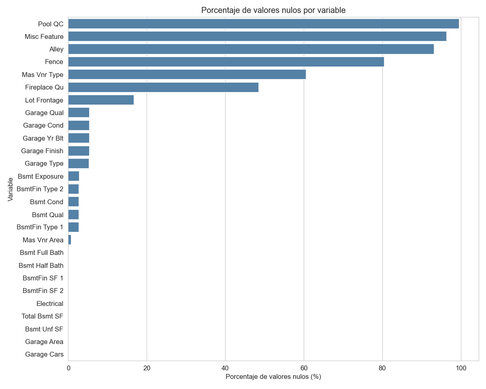

### 8.2 Variable objetivo: `SalePrice`

- Distribución **asimétrica hacia la derecha**: la mitad central de las viviendas se concentra entre US$ 129.500 y US$ 213.500 (percentiles 25 y 75), con casos de lujo hasta US$ 755.000.
- Se aplica la transformación `log1p` para corregir la asimetría (sección 9.2).

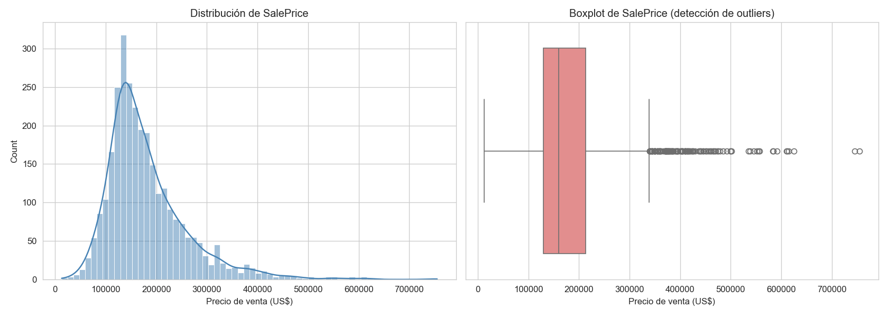

### 8.3 Correlaciones lineales y no lineales con `SalePrice`

Las variables numéricas más correlacionadas con el precio (Pearson) son:

| Variable | Pearson | Spearman | Kendall |
|---|---|---|---|
| `Overall Qual` (calidad general) | 0,80 | 0,81 | 0,67 |
| `Gr Liv Area` (área habitable) | 0,71 | 0,72 | 0,54 |
| `Garage Cars` (capacidad del garage) | 0,65 | 0,70 | 0,58 |
| `Garage Area` (área del garage) | 0,64 | 0,66 | 0,49 |
| `Total Bsmt SF` (área del sótano) | 0,63 | 0,61 | 0,44 |
| `1st Flr SF` (área del primer piso) | 0,62 | 0,58 | 0,42 |

**Por qué se agregaron Spearman y Kendall.** Pearson mide solo asociación *lineal* y es sensible a valores extremos. Como varias variables son ordinales, discretas o están concentradas en cero, se complementó con dos coeficientes basados en rangos: **Spearman** (detecta relaciones monótonas, robusto a outliers) y **Kendall** (maneja mejor los empates, frecuentes en variables discretas). `MS SubClass` se excluyó del análisis por ser un código nominal guardado como número.

**Qué revelan.** Hay variables cuya relación con el precio es monótona pero no lineal, y Pearson las subestima: `Year Built` (0,56 → 0,68 en Spearman), `Open Porch SF` (0,31 → 0,48) y `Lot Area` (0,27 → 0,43). En el sentido contrario, la correlación de Pearson de `BsmtFin SF 1` (0,43 → 0,33) y `Mas Vnr Area` (0,51 → 0,44) se apoya en pocos valores extremos o en muchos ceros.


### 8.4 Multicolinealidad entre variables predictoras

Se evaluó con la matriz de correlación de Spearman entre las 35 variables numéricas predictoras, el listado de pares correlacionados y la verificación de dependencias exactas.

- **17 pares** con |ρ| ≥ 0,60, de los cuales **4** tienen |ρ| ≥ 0,80:

| Par | Spearman | Pearson |
|---|---|---|
| `Year Built` – `Garage Yr Blt` | 0,90 | 0,84 |
| `Garage Cars` – `Garage Area` | 0,86 | 0,89 |
| `Total Bsmt SF` – `1st Flr SF` | 0,83 | 0,80 |
| `Gr Liv Area` – `TotRms AbvGrd` | 0,81 | 0,81 |

- **Dependencias exactas** (se cumplen en el 100% de las filas): `Gr Liv Area` = `1st Flr SF` + `2nd Flr SF` + `Low Qual Fin SF`, y `Total Bsmt SF` = `BsmtFin SF 1` + `BsmtFin SF 2` + `Bsmt Unf SF`.

**Por qué importa según el modelo.** En la Regresión Lineal la multicolinealidad vuelve inestables los coeficientes individuales: Ridge la reparte entre las variables correlacionadas y Lasso tiende a conservar solo una. En los modelos de árboles el poder predictivo casi no se ve afectado, pero la *importancia de variables* se diluye entre variables redundantes. En la sección 12.6 se mide empíricamente si eliminar variables correlacionadas cambia las métricas.


### 8.5 Detección sistemática de outliers

Para no limitar el análisis a un par de variables elegidas a mano, se aplicó el **método del rango intercuartílico (IQR)** a las **37 variables numéricas** (36 predictoras + `SalePrice`): un valor es atípico si cae fuera de `[Q1 - 1,5×IQR, Q3 + 1,5×IQR]`.

**Resultado:** 33 de las 37 variables presentan al menos un outlier. Sin embargo, la cantidad **no indica mala calidad de datos**; depende del tipo de variable:

- **Variables "zero-inflated"** (concentradas en 0): `Enclosed Porch` (459), `BsmtFin SF 2` (351), `Screen Porch` (256), `Mas Vnr Area` (200), `Open Porch SF` (159) y `Misc Val` (103). La mayoría de las viviendas simplemente no tiene esa característica, y el IQR marca como "atípica" a cualquiera que sí la tenga. No son errores: esa información es valiosa y **no se eliminan**.
- **`Overall Cond` (252 outliers, 8,6%)**: es ordinal (escala 1-10) y está muy concentrada en 5 ("Average"). El IQR, pensado para variables continuas, sobre-marca los extremos de la escala. Es una limitación conocida del método para variables discretas u ordinales.
- **`MS SubClass` (208)**: es un código nominal, así que el IQR no tiene sentido para ella.
- **`SalePrice` (137 outliers, 4,68%)**: confirma de forma sistemática el grupo de viviendas de alto valor visto en el histograma.

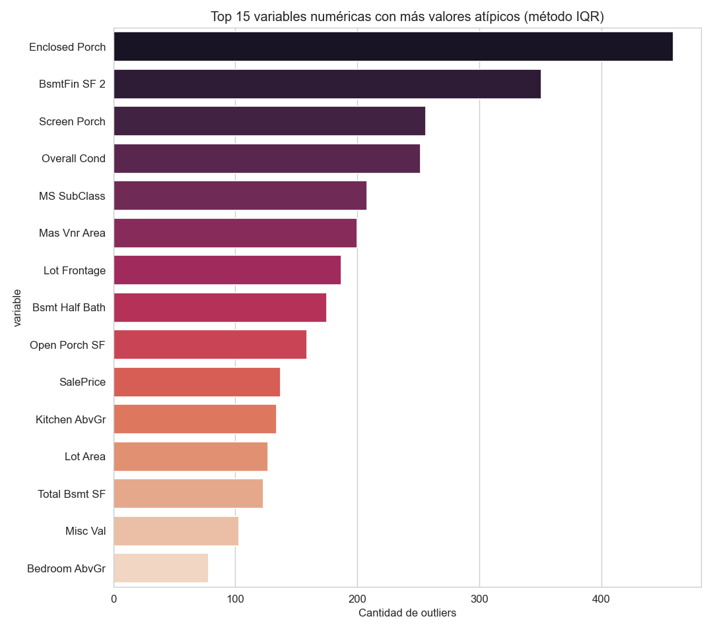

**Outliers evidentes eliminados.** Se identificaron **3 viviendas** con `Gr Liv Area` > 4.000 pies² y `SalePrice` < US$ 300.000 (`PID` 908154235, 908154195 y 908154205; todas en `Edwards` y con `Sale Condition` = `Partial`). Rompen la relación tamaño-precio y corresponden a ventas no representativas, por lo que se eliminaron. El modelamiento usa las **2.927 viviendas** restantes.

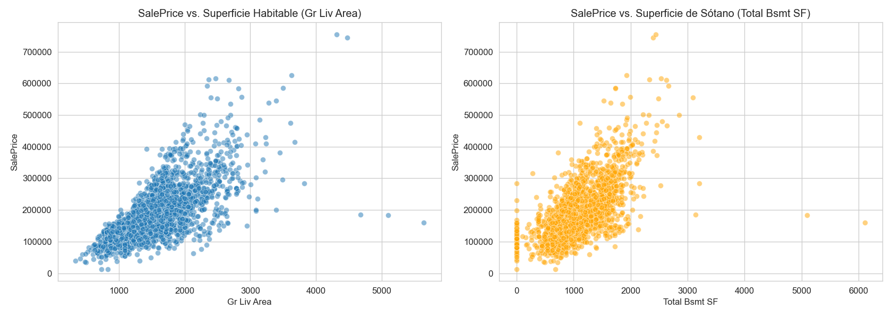

**Conclusión.** La estrategia no es eliminar sistemáticamente los valores atípicos, sino evaluarlos caso a caso según el tipo de variable. En la sección 12.6 se comprueba empíricamente que eliminar outliers **empeora** los tres modelos.

### 8.6 Relación entre variables categóricas y el precio

- **Ubicación:** el precio varía mucho según el barrio (`Neighborhood`): `NridgHt`, `NoRidge` y `StoneBr` concentran las viviendas más caras, y `MeadowV` e `IDOTRR` las más económicas.
- **Calidad:** hay una relación monótona clara entre `Overall Qual` (1 a 10) y el precio.

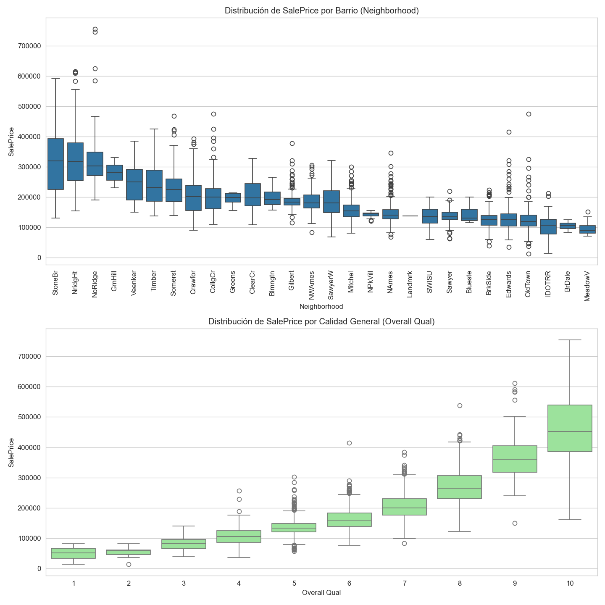

---

## 9. Preparación y transformación de los datos

### 9.1 Limpieza e imputación de valores nulos

**Nulos "estructurales" (ausencia del atributo):**
- Categóricas → `"None"`: `Pool QC`, `Misc Feature`, `Alley`, `Fence`, `Fireplace Qu`, `Garage Type/Finish/Qual/Cond`, `Bsmt Qual/Cond/Exposure`, `BsmtFin Type 1/2` y `Mas Vnr Type`.
- Numéricas → `0`: `Garage Yr Blt`, `Mas Vnr Area`, `BsmtFin SF 1/2`, `Bsmt Unf SF`, `Total Bsmt SF`, `Bsmt Full/Half Bath`, `Garage Cars` y `Garage Area`.

**Nulos reales (imputación estadística):**
- `Lot Frontage`: mediana **por barrio**, porque el frontis depende de la ubicación.
- `Electrical`: moda.
- Tres valores restantes (viviendas de barrios sin ningún `Lot Frontage` registrado) los resuelve el imputador del pipeline con la mediana.

**Otras decisiones:** se eliminan `Order` y `PID` (identificadores) y las 3 viviendas atípicas descritas en 8.5.

### 9.2 Transformación de la variable objetivo

Se crea `SalePrice_log = log1p(SalePrice)`, que reduce notoriamente la asimetría y favorece a los modelos lineales. Los modelos se entrenan sobre este logaritmo y **las métricas se calculan volviendo a dólares** con `expm1`.

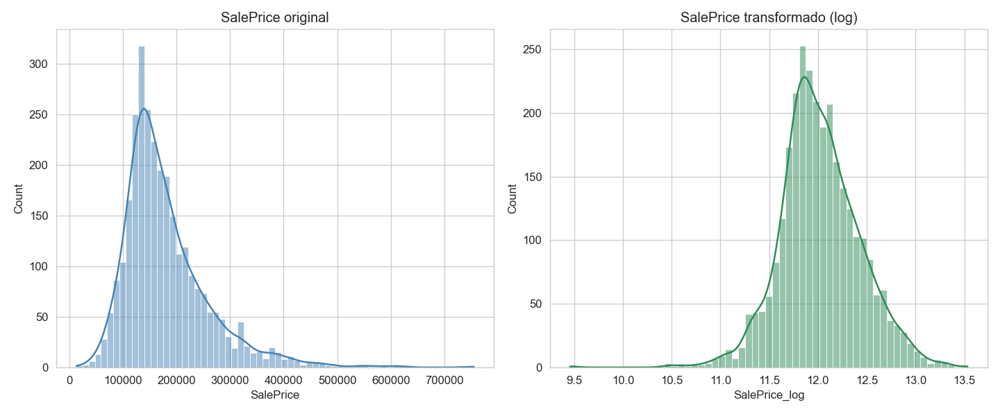

### 9.3 Pipeline de preprocesamiento (versión usada por los modelos finales, "v1")

Un `ColumnTransformer` de scikit-learn que:
- **Numéricas:** imputa con la mediana y estandariza (`StandardScaler`).
- **Categóricas:** imputa con la moda y aplica `OneHotEncoder`.

Se ajusta **solo con el conjunto de entrenamiento** para evitar fuga de información. La división es **80/20** (`random_state` = 42): **2.341** viviendas de entrenamiento y **586** de prueba. El resultado son **314 columnas**: 36 numéricas escaladas + 278 variables dummy.

### 9.4 Clasificación de las variables por tipo

La clasificación se definió a mano (no por tipo de dato), porque el *dtype* no distingue, por ejemplo, un código nominal guardado como número (`MS SubClass`) de una cantidad real.

| Grupo | N° variables | Columnas que genera hoy el One-Hot (v1) | Ejemplos |
|---|---|---|---|
| Numérica continua | 19 | 19 | `Lot Frontage`, `Lot Area`, `Mas Vnr Area`, `Gr Liv Area` |
| Numérica discreta | 14 | 14 | `Year Built`, `Full Bath`, `Garage Cars`, `Mo Sold` |
| Numérica ordinal (1-10) | 2 | 2 | `Overall Qual`, `Overall Cond` |
| Categórica ordinal | 19 | 97 | `Exter Qual`, `Kitchen Qual`, `Bsmt Qual`, `Garage Finish` |
| Categórica binaria | 2 | 4 | `Street`, `Central Air` |
| Categórica nominal, baja dimensionalidad (3-10 niveles) | 19 | 117 | `MS Zoning`, `Alley`, `Lot Config`, `Sale Type` |
| Nominal, alta dimensionalidad (> 10 niveles) | 4 | 61 | `Neighborhood` (28), `Exterior 1st`, `Exterior 2nd`, `MS SubClass` |
| **Total** | **79** | **314** | |

Esta clasificación coincide con la tabla 7.1, con una excepción: `Electrical` y `Fence` se tratan como **nominales**, porque sus niveles no tienen un orden natural claro.

**Cardinalidad.** Las variables nominales generan 181 dummies, y 52 niveles tienen menos de 10 viviendas en entrenamiento (por ejemplo `Condition 2`: 7 de sus 8 niveles son raros). Esos niveles aportan columnas casi vacías.

**Asimetría de las continuas.** Hay 17 de 19 variables continuas con asimetría mayor a 0,75 en valor absoluto (por ejemplo `Misc Val` 20,5, `Pool Area` 17,4, `Lot Area` 13,7); solo `Total Bsmt SF` (0,34) y `Garage Area` (0,21) son aproximadamente simétricas.

### 9.5 Método de transformación según el tipo de variable

| Tipo de variable | Transformación (v2) | Justificación |
|---|---|---|
| Continua con asimetría alta (17 variables) | `log1p` + estandarización | Reduce la asimetría y el peso de valores extremos; `log1p` admite ceros (variables zero-inflated) |
| Continua simétrica | Estandarización | Pone la variable en la misma escala sin alterar su forma |
| Discreta y ordinal numérica | Estandarización | El orden ya está codificado en el número |
| Categórica ordinal | `OrdinalEncoder` con orden explícito (p. ej. `None` < `Po` < `Fa` < `TA` < `Gd` < `Ex`) + estandarización | Conserva el orden natural y usa **1 columna** en vez de una por nivel |
| Nominal baja dimensionalidad y binaria | One-Hot | No hay orden entre niveles; pocas columnas |
| Nominal alta dimensionalidad | One-Hot agrupando niveles con menos de 10 viviendas | Evita columnas casi vacías que añaden ruido |
| `MS SubClass` | One-Hot | Es un código nominal, no una cantidad |

### 9.6 Comparación de preprocesamientos (ablación)

Para decidir si esta estrategia ayuda, se comparó con el pipeline v1 usando el **mismo modelo (Ridge)** y la misma validación cruzada de 3 pliegues, solo con datos de entrenamiento. El RMSE se mide sobre el logaritmo del precio (menor es mejor):

| Preprocesamiento | Columnas | RMSE CV (log) |
|---|---|---|
| v1 actual (todo One-Hot) | 314 | 0,1229 |
| **v2 completo** | **216** | **0,1192** |
| v2 sin `log1p` en continuas | 216 | 0,1209 |
| v2 sin codificación ordinal | 285 | 0,1193 |
| v2 sin agrupar niveles raros | 250 | 0,1195 |

- v2 mejora el RMSE de validación cruzada en ≈ 3% (0,1229 → 0,1192) y usa **98 columnas menos**.
- El mayor aporte viene del `log1p` en las continuas; la codificación ordinal casi no cambia el error, pero reduce 69 columnas.

**Decisión.** Se mantiene el preprocesamiento v1 en los modelos finales, para que los tres algoritmos reciban exactamente las mismas variables y las diferencias de desempeño se deban al algoritmo y no a la preparación. v2 queda documentado como una mejora posible.

### 9.7 ¿Conviene reducir la dimensionalidad con PCA?

Se aplicó PCA sobre las variables preprocesadas (ajustado solo con entrenamiento):

| Varianza explicada | Componentes (v1, 314 col.) | Componentes (v2, 216 col.) |
|---|---|---|
| 80% | 31 | 29 |
| 90% | 54 | 44 |
| 95% | 80 | 63 |
| 99% | 138 | 109 |

Luego se entrenó Ridge sobre los componentes principales (PCA dentro del pipeline, sin fuga de datos):

| Preprocesamiento | Columnas | RMSE CV (log) |
|---|---|---|
| v1 sin PCA (referencia) | 314 | 0,1229 |
| v1 + PCA (95% de varianza) | 80 | 0,1253 |
| v1 + PCA (99% de varianza) | 138 | 0,1237 |
| v2 + PCA (95% de varianza) | 63 | 0,1259 |
| v2 + PCA (99% de varianza) | 109 | 0,1212 |

**Conclusión: no se usa PCA en los modelos finales.** En todos los casos el error empeora o no mejora frente a no reducir (por ejemplo v2 sin PCA: 0,1192 frente a 0,1212 con PCA al 99%), y los componentes pierden la interpretabilidad de las variables originales, que es una prioridad del negocio. La regularización de Ridge y Lasso ya controla el exceso de columnas. PCA se usa solo con fines de visualización de los segmentos de K-Means.


---

## 10. Justificación de la selección de modelos

### Modelos supervisados (los tres definidos en la Evaluación 1)

| Modelo | Por qué corresponde al problema | Configuración explorada |
|---|---|---|
| **Regresión Lineal regularizada** (Ridge y Lasso; se conserva el mejor) | Línea base **interpretable**. Tras el `log1p` del objetivo la relación con las variables es más lineal. La regularización es necesaria porque el One-Hot deja **314 columnas** para 2.341 filas y varias variables están muy correlacionadas | `alpha` de Ridge: 0,1 a 100 · `alpha` de Lasso: 0,0001 a 0,01 |
| **Random Forest Regressor** | Captura **no linealidades e interacciones** (p. ej. calidad × barrio) sin especificarlas; entrega importancia de variables | `max_depth`, `min_samples_leaf`, `max_features` (200 árboles; búsqueda aleatoria de 5 combinaciones) |
| **Gradient Boosting Regressor** | Suele dar el **mejor desempeño** en datos tabulares de este tamaño; es el "techo de desempeño" | `n_estimators` (300 y 500), `learning_rate` = 0,05, `max_depth` (3 y 4), `subsample` = 0,8, `max_features` = 0,5 |

**Cómo se ajusta cada uno (igual para los tres, para que la comparación sea justa):**
- Se entrena un `Pipeline` = preprocesador + modelo, de modo que imputación, escalado y One-Hot se reajustan **dentro de cada partición** de la validación cruzada (sin fuga de información).
- Los hiperparámetros se eligen con **validación cruzada de 3 pliegues sobre el conjunto de entrenamiento**, minimizando el RMSE sobre el logaritmo del precio.
- El conjunto de prueba **no participa** en la elección de hiperparámetros.

### Modelo no supervisado (complemento)

| Modelo | Por qué se agrega | Qué aporta al negocio |
|---|---|---|
| **K-Means** (con PCA para visualizar) | Segmenta el mercado en tipos de vivienda usando solo sus características físicas (sin el precio) | Entender la estructura del mercado, validar que los segmentos tengan precios distintos y auditar el modelo supervisado por segmento |

K-Means se suma como cuarto modelo sin reemplazar a ninguno de los tres supervisados.

---

## 11. Variables finales e implementación de los modelos

### 11.1 Variables que recibe cada modelo

Los tres modelos supervisados reciben **las mismas 314 columnas** del pipeline v1 (36 numéricas escaladas + 278 dummies de 43 categóricas). K-Means usa un conjunto distinto de 9 variables.

| Modelo | Columnas de entrada | Columnas con peso distinto de 0 | Observación |
|---|---|---|---|
| **Ridge** | 314 | 314 | Regularización L2: reduce los coeficientes sin anularlos |
| **Lasso** | 314 | 82 | Regularización L1: anula el 74% de las columnas (selección automática) |
| **Random Forest** | 314 | 266 | 26 columnas acumulan el 90% de la importancia |
| **Gradient Boosting** | 314 | 267 | 20 columnas acumulan el 90% de la importancia |
| **K-Means** | 9 | 9 | `Overall Qual`, `Gr Liv Area`, `Garage Cars`, `Garage Area`, `Total Bsmt SF`, `1st Flr SF`, `Year Built`, `Full Bath`, `Year Remod/Add`, estandarizadas |

K-Means **no** usa `SalePrice` (para poder validar los segmentos con el precio) ni `Garage Yr Blt` (su valor 0 para "sin garage" no es un año real y distorsionaría las distancias).

### 11.2 Hiperparámetros elegidos por validación cruzada

| Modelo | Hiperparámetros finales | RMSE CV (escala log) |
|---|---|---|
| Ridge | `alpha` = 30 | 0,1229 |
| Lasso | `alpha` = 0,001 | 0,1237 |
| Random Forest | `n_estimators` = 200, `max_depth` = 15, `min_samples_leaf` = 2, `max_features` = 0,33 | 0,1375 |
| Gradient Boosting | `n_estimators` = 500, `learning_rate` = 0,05, `max_depth` = 4, `subsample` = 0,8, `max_features` = 0,5 | 0,1244 |
| K-Means | `n_clusters` = 3, `n_init` = 20, `random_state` = 42 | silueta 0,2495 |

Entre Ridge y Lasso se conserva **Ridge** por tener el menor RMSE de validación cruzada. Todos los procesos aleatorios usan `random_state` = 42.

### 11.3 Elección de k en K-Means

Se probaron valores de k entre 2 y 8:

| k | 2 | 3 | 4 | 5 | 6 | 7 | 8 |
|---|---|---|---|---|---|---|---|
| Silueta | 0,327 | 0,250 | 0,222 | 0,214 | 0,220 | 0,218 | 0,228 |

La silueta es máxima en k = 2, pero esa partición solo separa dos grandes bloques. Con **k = 3** se obtiene una segmentación interpretable para el negocio (económica, intermedia y premium), y para k ≥ 4 no aparece un grupo con significado nuevo. La silueta moderada indica que los tipos de vivienda forman más un continuo que grupos aislados.

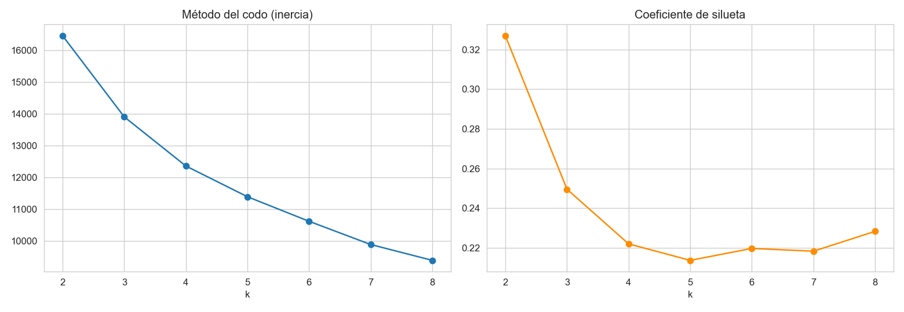

---

## 12. Evaluación y selección del modelo

### 12.1 Desempeño en el conjunto de prueba (586 viviendas)

| Modelo | R² | RMSE (US$) | MAE (US$) | MAPE (%) | R² entrenamiento |
|---|---|---|---|---|---|
| **Regresión Lineal (Ridge)** | **0,959** | **18.170** | 12.574 | 7,15 | 0,944 |
| Random Forest | 0,921 | 25.294 | 14.726 | 7,88 | 0,976 |
| Gradient Boosting | 0,954 | 19.246 | **12.406** | **6,84** | 0,988 |

### 12.2 Contraste con los umbrales de aceptación

| Métrica | Umbral | Ridge | Random Forest | Gradient Boosting |
|---|---|---|---|---|
| R² | ≥ 0,80 | ✅ 0,959 | ✅ 0,921 | ✅ 0,954 |
| RMSE | ≤ US$ 30.000 | ✅ 18.170 | ✅ 25.294 | ✅ 19.246 |
| MAE | ≤ US$ 20.000 | ✅ 12.574 | ✅ 14.726 | ✅ 12.406 |
| MAPE | ≤ 12% | ✅ 7,15% | ✅ 7,88% | ✅ 6,84% |

**Los tres modelos cumplen los cuatro umbrales**, por lo que el criterio de salida de la Evaluación 1 se cumple en la primera iteración.

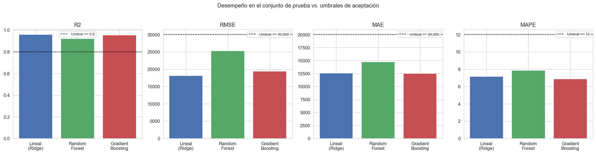

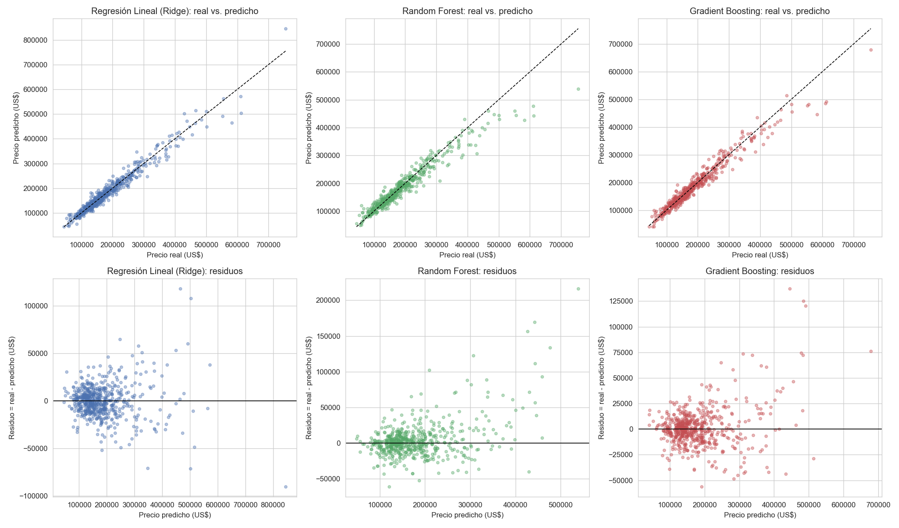

### 12.3 Modelo seleccionado: Regresión Ridge

**Regla de selección:** entre los modelos que cumplen los cuatro umbrales, se elige el de **menor RMSE** en el conjunto de prueba, la métrica que más penaliza los errores grandes de tasación.

- **Ridge explica ≈ 96% de la variabilidad del precio** en viviendas que nunca vio. Su RMSE (US$ 18.170) está ≈ 39% por debajo del límite y equivale a ≈ 11% del precio mediano; su MAE (US$ 12.574) está ≈ 37% por debajo del límite. **La predicción típica se equivoca en torno a US$ 12.600, es decir, ≈ 7% del valor de la vivienda.**
- **¿Por qué Ridge y no Gradient Boosting?** Las diferencias son pequeñas: Gradient Boosting tiene un MAE (US$ 12.406) y un MAPE (6,84%) marginalmente menores, pero Ridge logra **menor RMSE en el conjunto de prueba** (US$ 18.170 frente a US$ 19.246) **y también en validación cruzada** (0,1229 frente a 0,1244 en escala logarítmica), de modo que ambas fuentes de evidencia coinciden. Además, Gradient Boosting muestra **mayor sobreajuste** (R² 0,988 en entrenamiento frente a 0,954 en prueba), mientras que Ridge es estable (0,944 frente a 0,959). Y Ridge es el modelo **más explicable**, prioridad planteada en la Evaluación 1.
- **Random Forest** es el de menor desempeño: cumple los umbrales con el menor margen y muestra sobreajuste (R² 0,976 en entrenamiento frente a 0,921 en prueba).
- **Conclusión:** en este dataset, tras la transformación logarítmica y la preparación de datos, el modelo simple y regularizado **compite de igual a igual con el más complejo**. Esto respalda haber incluido la regresión lineal como línea base seria.

### 12.4 Variables más influyentes

Como el objetivo está en logaritmo, un coeficiente `b` equivale a un cambio aproximado de `(e^b − 1)` en el precio. Las numéricas están estandarizadas (efecto por cada desviación estándar); las categóricas son dummies (0/1).

| Variable | Coeficiente | Efecto aproximado en el precio |
|---|---|---|
| `Overall Qual` (calidad general) | 0,086 | ≈ +9% por desviación estándar |
| `Gr Liv Area` (superficie habitable) | 0,071 | ≈ +7% por desviación estándar |
| Barrio `Crawfor` | 0,069 | ≈ +7% |
| `Sale Condition` anormal (`Abnorml`) | −0,066 | ≈ −6% |
| `Functional` típica (`Typ`) | 0,053 | ≈ +5% |
| `MS Zoning` comercial (`C (all)`) | −0,051 | ≈ −5% |
| Barrio `MeadowV` | −0,050 | ≈ −5% |

**Hallazgo de negocio:** las ventas anormales (p. ej. ejecuciones o ventas apremiadas) se asocian a precios menores, porque su precio **no es el precio de mercado** de la propiedad.

**Advertencias de interpretación:** las variables muy correlacionadas (`1st Flr SF`, `2nd Flr SF`, `Gr Liv Area`) se reparten el efecto, así que sus coeficientes no deben leerse de forma aislada; y estos coeficientes describen **asociación, no causalidad**.

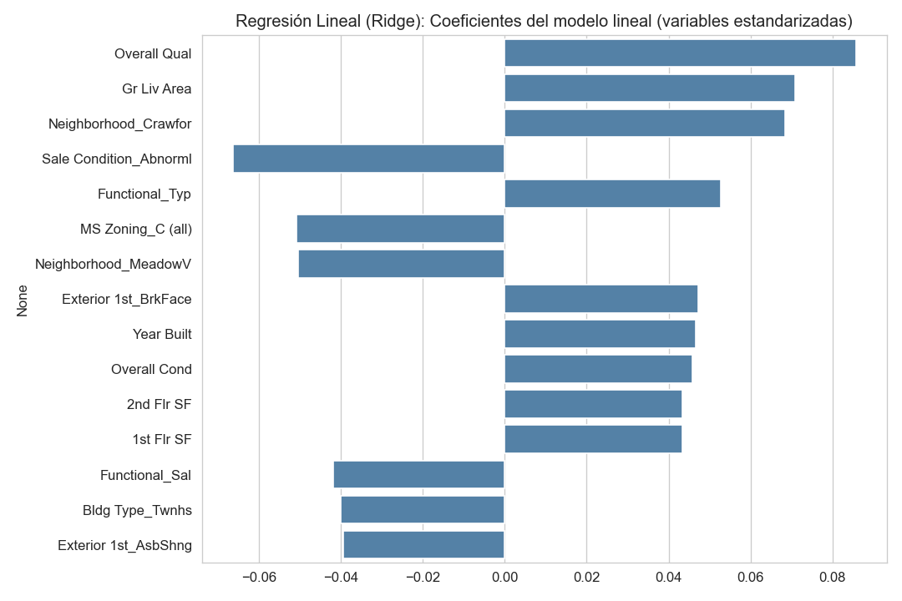

### 12.5 ¿Dónde se equivoca más el modelo?

**Por barrio** (21 barrios con al menos 8 ventas en prueba):

| Barrio | Ventas en prueba | MAE (US$) | MAPE (%) |
|---|---|---|---|
| `ClearCr` | 10 | 22.846 | **12,5** |
| `BrkSide` | 25 | 10.065 | 10,2 |
| `Crawfor` | 16 | 20.551 | 9,5 |
| ... | ... | ... | ... |
| `NoRidge` | 13 | **32.457** | 8,1 |
| ... | ... | ... | ... |
| `CollgCr` | 47 | 8.141 | 4,2 |

El MAPE va de ≈ 4% (`CollgCr`) a ≈ 12,5% (`ClearCr`). **`ClearCr` supera el umbral de 12%**, aunque con solo 10 ventas en prueba, por lo que es una señal a vigilar y no una conclusión firme. `NoRidge` (barrio de viviendas caras) tiene el mayor error absoluto. Esto confirma el riesgo planteado en la sección 13: **el desempeño no es uniforme entre barrios**.

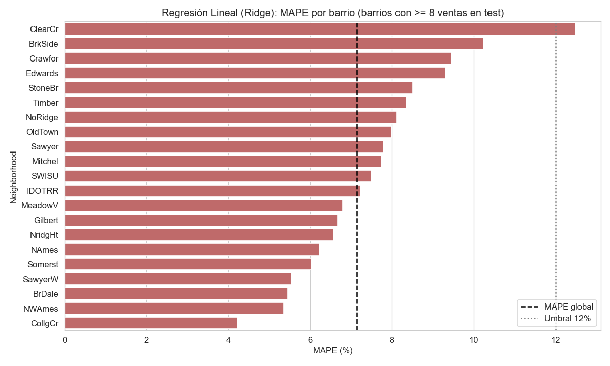

**Por tramo de precio** (cuatro tramos del mismo tamaño):

| Tramo | Viviendas | Precio medio (US$) | MAE (US$) | MAPE (%) |
|---|---|---|---|---|
| Q1 (más baratas) | 147 | 104.120 | 8.436 | 8,9 |
| Q2 | 149 | 143.278 | 9.882 | 6,9 |
| Q3 | 143 | 182.030 | 11.435 | 6,3 |
| Q4 (más caras) | 147 | 303.153 | 20.550 | 6,5 |

El error **absoluto** crece con el precio, pero el error **relativo** es mayor en las viviendas baratas: un error de US$ 8.000 pesa más en una casa de US$ 100.000 que uno de US$ 20.000 en una de US$ 300.000.

**Por segmento de K-Means** (sección 12.7): el MAPE es parejo entre segmentos (6,6% a 7,7%), todos bajo el umbral de 12%.

### 12.6 Pruebas con distintos subconjuntos de datos

Para saber si el desempeño depende de los outliers o de las variables redundantes, se reentrenaron los tres modelos (con los hiperparámetros ya elegidos, sin repetir la búsqueda) en cuatro escenarios, **sin modificar nunca el conjunto de prueba**:

- **A) Base:** todos los datos.
- **B) Sin outliers:** se excluyen del entrenamiento las filas atípicas (IQR 1,5) en `Lot Frontage`, `Lot Area`, `Gr Liv Area`, `1st Flr SF`, `Total Bsmt SF`, `Garage Area` y en el precio: 371 de 2.341 filas (15,8%). Los límites se calculan solo con entrenamiento.
- **C) Sin variables correlacionadas:** de cada par de variables numéricas con correlación de Pearson ≥ 0,80 (en valor absoluto), se elimina la que tiene mayor correlación media con el resto (sin usar el precio). Se eliminaron `Gr Liv Area` (par con `TotRms AbvGrd`, r = 0,81) y `Garage Cars` (par con `Garage Area`, r = 0,89).
- **D) B + C.**

**Resultado en la partición de prueba (RMSE en US$):**

| Escenario | Ridge | Random Forest | Gradient Boosting |
|---|---|---|---|
| A) Base | 18.170 | 25.294 | 19.246 |
| B) Sin outliers | 26.901 (+48,1%) | 34.517 (+36,5%) | 27.407 (+42,4%) |
| C) Sin variables correlacionadas | 18.088 (−0,5%) | 27.109 (+7,2%) | 20.106 (+4,5%) |
| D) B + C | 27.117 (+49,2%) | 36.119 (+42,8%) | 27.418 (+42,5%) |

**¿Son diferencias reales o ruido?** Con una sola partición de 586 viviendas una diferencia pequeña puede ser azar. Por eso se repitió la comparación en **10 particiones de validación cruzada** (5 pliegues × 2 repeticiones, solo con datos de entrenamiento). En cada partición los escenarios usan las mismas viviendas de validación (comparación pareada) y los outliers se detectan solo con la parte de entrenamiento de esa partición:

| Modelo | Escenario | RMSE base (US$) | RMSE escenario (US$) | Cambio | Peor que la base en | p (Wilcoxon) | Conclusión |
|---|---|---|---|---|---|---|---|
| Ridge | B) Sin outliers | 20.692 | 28.791 | +39,1% | 8 de 10 | 0,027 | Empeora |
| Ridge | C) Sin correlacionadas | 20.692 | 20.811 | +0,6% | 8 de 10 | 0,065 | Sin diferencia significativa |
| Random Forest | B) Sin outliers | 25.063 | 29.852 | +19,1% | 10 de 10 | 0,002 | Empeora |
| Random Forest | C) Sin correlacionadas | 25.063 | 26.240 | +4,7% | 10 de 10 | 0,002 | Empeora |
| Gradient Boosting | B) Sin outliers | 21.236 | 24.874 | +17,1% | 10 de 10 | 0,002 | Empeora |
| Gradient Boosting | C) Sin correlacionadas | 21.236 | 21.877 | +3,0% | 8 de 10 | 0,037 | Empeora |

*Los p-valores son orientativos: las particiones repetidas comparten datos, por lo que la columna "Peor que la base en" muestra mejor la consistencia del efecto. El RMSE de la validación cruzada es mayor que el de la prueba porque entrena con menos datos y evalúa otras viviendas.*

**Conclusiones:**
1. **Eliminar outliers empeora a los tres modelos de forma significativa** (entre +17% y +39% en RMSE). Las viviendas de alto valor son observaciones legítimas que el modelo necesita aprender a predecir; por eso se mantienen. Una limitación: el escenario B quita tanto filas atípicas en variables como filas con precio atípico, y la validación incluye viviendas caras que el modelo ya no vio.
2. **Eliminar variables correlacionadas no mejora a ningún modelo.** Ridge no cambia de forma significativa (+0,6%), gracias a su regularización; los árboles empeoran levemente (+3% a +5%). La multicolinealidad afecta la interpretación individual de los coeficientes, no la capacidad de predicción. Se conservan todas las variables.
3. **Ridge es el mejor en los escenarios A y C** (en validación cruzada: 20.692 frente a 21.236 de Gradient Boosting en A, y 20.811 frente a 21.877 en C). **En el escenario B, Gradient Boosting supera a Ridge** (24.874 frente a 28.791): Ridge es el modelo más dependiente de los valores extremos.

### 12.7 Segmentación del mercado con K-Means (k = 3)

Los tres segmentos se formaron **sin usar el precio** y, aun así, quedan con precios medianos claramente distintos. Esto valida que las características físicas identificadas en el EDA ordenan el mercado.

| Segmento | Viviendas | Precio mediano (US$) | Perfil | Barrios más frecuentes |
|---|---|---|---|---|
| **Premium** | 516 (18%) | 287.000 | Calidad ≈ 7,9 · ≈ 2.064 pies² habitables · garage para ≈ 2,7 autos · construcción ≈ 1996 | `NridgHt` (25%), `Somerst` (13%), `CollgCr` (12%) |
| **Intermedio** | 1.077 (37%) | 185.000 | Calidad ≈ 6,5 · ≈ 1.579 pies² · garage para 2 autos · construcción ≈ 1987 | `CollgCr` (15%), `Gilbert` (14%), `Somerst` (10%) |
| **Económico** | 1.334 (46%) | 128.000 | Calidad ≈ 5,1 · ≈ 1.209 pies² · garage más pequeño · construcción ≈ 1948 | `NAmes` (26%), `OldTown` (16%), `Edwards` (11%) |

**Desempeño del modelo final en cada segmento** (viviendas de prueba):

| Segmento | Viviendas en prueba | MAE (US$) | MAPE (%) |
|---|---|---|---|
| Premium | 107 | 22.303 | 6,6 |
| Intermedio | 205 | 12.272 | 6,7 |
| Económico | 274 | 9.002 | 7,7 |

El modelo se comporta de forma bastante pareja en términos relativos; el error absoluto crece con el nivel de precio, y el segmento económico tiene el mayor error relativo, coherente con lo visto por tramo de precio.

**Límite:** los grupos se solapan (silueta ≈ 0,25), así que una vivienda cercana a la frontera entre dos segmentos puede pertenecer a cualquiera de ellos.

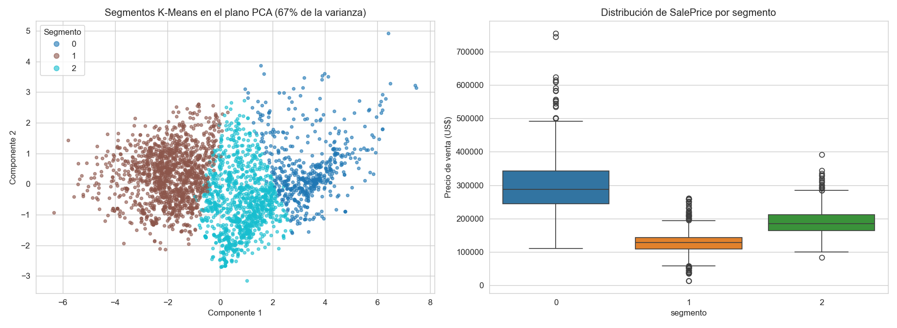

### 12.8 Despliegue (fase de CRISP-DM)

El modelo final se guarda como **pipeline completo** (preprocesamiento + modelo) en `models/modelo_final_housing.pkl`, de modo que se puede predecir directamente a partir de las columnas originales de una vivienda. Se verificó la recarga con una vivienda del conjunto de prueba (predicho US$ 313.073; real US$ 298.236). **No se despliega en producción**: queda preparado para hacerlo.

---

## 13. Análisis de sesgos, ética y privacidad

### 13.1 Sesgos

- **Sesgo geográfico y temporal.** El dataset corresponde solo a **Ames, Iowa, entre 2006 y 2010** (periodo que incluye la crisis subprime). El modelo **no debe generalizarse** a otras ciudades, países ni condiciones de mercado muy distintas (por ejemplo, el mercado chileno) sin validación adicional.
- **Sesgo socioeconómico vía `Neighborhood`.** El barrio tiene alto poder predictivo, por lo que existe el riesgo de que el modelo **replique y refuerce desigualdades históricas** entre barrios (barrios históricamente menos valorados seguirán prediciéndose con precios bajos). El modelo debe usarse como **apoyo a la decisión**, no como única fuente de verdad, sobre todo en contextos con impacto en créditos hipotecarios o políticas urbanas.
- **Sesgo de representatividad entre barrios.** Los datos son transacciones reales (precios efectivamente pagados, no precios de publicación u oferta), por lo que no hay sesgo por precios inflados. El riesgo real es la **representatividad desigual**: `NAmes` concentra el 15,1% de las ventas y los 5 barrios más grandes el 45,1%, mientras que 7 barrios tienen menos de 30 ventas (`GrnHill` 2, `Landmrk` 1).

  Se midió si esto se traduce en más error: entre los 23 barrios con al menos 3 ventas en prueba, **no se observa que los barrios con menos ventas tengan mayor error** (correlación de Spearman entre ventas en entrenamiento y MAPE: ρ = −0,24, p = 0,27; MAPE promedio de 8,2% en los 6 barrios con menos de 50 ventas frente a 7,4% en los 17 más grandes). Sin embargo, la evidencia es limitada: con pocas ventas de prueba el error por barrio es inestable, y en `GrnHill` y `Landmrk` **ni siquiera puede medirse** (ninguna venta cayó en el conjunto de prueba). Los dos barrios más cercanos al umbral de 12% (`ClearCr` 12,5% y `Blmngtn` 11,7%) son pequeños, pero con 10 y 7 ventas de prueba esto es una señal a vigilar, no una tendencia.

  

- **Variables sensibles indirectas (*proxy bias*).** No hay variables explícitas de raza, género o nivel socioeconómico, pero `Neighborhood` puede actuar como *proxy* de la composición socioeconómica o étnica de un sector, fenómeno documentado en la literatura de *fairness* en modelos de tasación. Por eso el error se mide desagregado por barrio (sección 12.5).
- **Mitigación:**
  - Documentar el alcance geográfico y temporal del modelo.
  - No usar el modelo en barrios sin respaldo suficiente de datos y derivar a revisión humana los barrios con error cercano o superior al umbral (`ClearCr`, `Blmngtn`).
  - Monitorear el error por barrio y reentrenar a medida que se acumulen ventas en los barrios poco representados.
  - No usar el modelo como única fuente de decisión en créditos o seguros.

### 13.2 Privacidad

- El dataset **no contiene información personal identificable**: no incluye nombres de propietarios, direcciones exactas, RUT/SSN ni datos de contacto. `PID` es un número de parcela catastral de carácter público y no identifica directamente a una persona.
- Se recomienda **no cruzar este dataset con otras fuentes** (por ejemplo, registros públicos de propietarios), porque la combinación de ubicación y características únicas podría permitir identificar un inmueble y, por extensión, a su propietario.

### 13.3 Consideraciones éticas de uso

- El modelo es una **herramienta de apoyo a la tasación**, no un reemplazo del criterio de un tasador certificado, sobre todo en decisiones con impacto financiero relevante.
- Se recomienda **transparentar las variables** que más influyen en cada predicción (el modelo lineal lo permite de forma directa; SHAP puede complementarlo en el futuro).
- Cualquier despliegue debería incluir **monitoreo periódico** para detectar *data drift* y sesgos emergentes.
- El uso debe ser consistente con la normativa local de protección de datos (en Chile, la Ley N°19.628 sobre Protección de la Vida Privada), especialmente si se integran datos con información personal de compradores o vendedores.

---

## 14. Interpretación y recomendaciones de negocio

1. **Usar el modelo como precio de referencia inicial** para tasadores y agentes, no como tasación final. Entrega una respuesta inmediata y consistente, lo que ataca los problemas de inconsistencia y lentitud descritos en la sección 1.
2. **Mostrar siempre un rango y no un número único.** Con un error típico (MAE) de ≈ US$ 12.600, una presentación como "US$ X ± 12.600" es más honesta que un precio exacto. Para viviendas del cuarto de mayor precio, el rango debería ser más amplio (≈ ± US$ 20.000).
3. **Derivar a revisión humana** las propiedades de alto valor, las de barrios con mayor error (`ClearCr`, `BrkSide`, `NoRidge`) y las ventas de condición anormal.
4. **Usar los segmentos** (premium, intermedio, económico) para ordenar la cartera y adaptar el discurso comercial y el nivel de revisión.
5. **No usar el modelo para decisiones con impacto directo en personas** (créditos hipotecarios, seguros) sin validación adicional.
6. **Respetar el alcance:** el modelo se entrenó con ventas de Ames, Iowa, entre 2006 y 2010; no debe aplicarse a otras ciudades ni al mercado chileno sin reentrenar con datos locales.
7. **Monitorear y reentrenar:** vigilar periódicamente el error global y por barrio, y reentrenar cuando el mercado cambie.

---

## 15. Limitaciones y posibles mejoras

**Limitaciones:**
- **Búsqueda de hiperparámetros acotada:** cuadrículas pequeñas y validación cruzada de 3 pliegues, para que el notebook se ejecute en tiempos razonables. Una búsqueda más amplia podría mejorar sobre todo a Random Forest y Gradient Boosting.
- **Una sola partición train/test:** con 586 viviendas de prueba, diferencias pequeñas entre modelos (como Ridge frente a Gradient Boosting) no deben sobreinterpretarse; la validación cruzada apunta en la misma dirección.
- **División aleatoria, no temporal:** el dataset cubre 2006-2010; una validación por fecha de venta sería más exigente.
- **Fuga de información menor:** la mediana de `Lot Frontage` por barrio y la eliminación de las 3 viviendas atípicas se calcularon antes de dividir en entrenamiento y prueba. El efecto es mínimo.
- **Decisiones heredadas que podrían revisarse:** `Garage Yr Blt` usa `0` para "sin garage" (no es un año real); el preprocesamiento v2, que mejora ≈ 3% el error de validación cruzada, no se usó en los modelos finales para mantener la comparabilidad.
- **Retransformación del logaritmo:** `expm1` de la predicción del logaritmo estima la mediana condicional, lo que puede subestimar levemente el precio promedio.
- **Muestras pequeñas por barrio:** el error por barrio se calcula con pocas ventas de prueba; los barrios con menos de 8 se omiten de los gráficos.
- **Segmentos solapados:** la silueta moderada indica fronteras difusas entre segmentos.
- **Prueba de outliers:** el escenario "sin outliers" mezcla filas atípicas en variables y en precio, y se evalúa sobre viviendas de prueba que sí incluyen casos extremos.

**Posibles mejoras:** adoptar el preprocesamiento v2; validación cruzada repetida con una búsqueda más amplia; probar XGBoost o LightGBM; modelos separados por segmento; interpretabilidad con SHAP; intervalos de predicción en lugar de predicciones puntuales; y validación temporal.

---

## 16. Estructura del proyecto y cómo ejecutarlo

```
housing-prices-ml/
├── README.md          <- informe técnico (este documento)
├── requirements.txt   <- dependencias de Python
├── .gitignore         <- archivos a ignorar en Git
├── data/              <- Ames_Iowa_Housing_Dataset.csv (entrada) y archivos generados
│                         (housing_clean.csv, resultados_modelos.csv, X_train.csv, ...)
├── notebooks/         <- Housing_EV1_EV2.ipynb (notebook principal)
├── models/            <- preprocessor_pipeline.pkl y modelo_final_housing.pkl (se generan al ejecutar)
└── images/            <- gráficos exportados (se generan al ejecutar)
```

### Cómo ejecutar el proyecto

1. **Instalar dependencias:**
   ```bash
   pip install -r requirements.txt
   ```
2. **Colocar el dataset:** asegurarse de que `Ames_Iowa_Housing_Dataset.csv` esté en la carpeta `data/`.
3. **Ejecutar el notebook** (también funciona en Google Colab subiendo la carpeta del proyecto y ubicándose en `notebooks/`):
   ```bash
   jupyter notebook notebooks/Housing_EV1_EV2.ipynb
   ```
   - El notebook debe ejecutarse **de arriba hacia abajo**: la Parte 2 usa las variables que construye la Parte 1.
   - La ejecución completa toma aproximadamente 20 a 30 minutos. Lo más lento son el Random Forest (≈ 3 minutos) y la validación cruzada repetida de las pruebas con subconjuntos.
   - Si se vuelven a leer `X_train.csv` / `X_test.csv`, usar `pd.read_csv(..., keep_default_na=False)`: de lo contrario pandas interpreta el texto `"None"` como nulo y se pierde la distinción entre "sin garage" y "dato faltante".

### Metodología

El proyecto sigue **CRISP-DM**:

| Fase | Qué se hizo | Dónde |
|---|---|---|
| 1. Comprensión del negocio | Problema de tasación, objetivos, métricas y criterio de salida cuantitativo | Secciones 1 a 6 |
| 2. Comprensión de los datos | Fuente, calidad (duplicados, nulos, outliers), correlaciones y multicolinealidad | Secciones 7 y 8 |
| 3. Preparación de los datos | Limpieza, imputación diferenciada, clasificación por tipo, transformación del objetivo, pipeline, comparación v1/v2 y PCA | Sección 9 |
| 4. Modelamiento | Tres modelos supervisados con ajuste de hiperparámetros y segmentación con K-Means | Secciones 10 y 11 |
| 5. Evaluación | Métricas en prueba, umbrales, subconjuntos, análisis por barrio, tramo de precio y segmento | Sección 12 |
| 6. Despliegue | Pipeline completo guardado y recomendaciones de uso y monitoreo | Secciones 12.8 y 14 |

**Naturaleza iterativa de CRISP-DM — un ejemplo real:** al explorar la segmentación se observó que `Garage Yr Blt` contiene el valor `0` para las viviendas sin garage (decisión de imputación de la sección 9.1). Ese `0` no es un año real y generaba un segmento artificial de "casas sin garage". Se volvió a la fase de preparación y se excluyó esa variable **solo de la segmentación**, sin tocar el resto del procesamiento.
